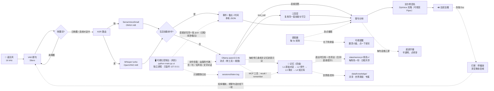

# 本地语音到语音助手（全离线）

[](LICENSE)

**SenseVoiceSmall / Whisper-large-v3-turbo → Ollama qwen3.5:4b → 凯尔希音色（ZipVoice 零样本克隆，可一行改回 Piper）**
（可选：某个角色可以把「脑子」和「嗓子」都切到 DeepSeek API —— 见第 14 节。）

完全跑在本机的「说话 → 识别 → 思考 → 说话」闭环，不联网、不上传任何数据。
支持唤醒词常驻待命、闹钟与会议提醒、备忘、日程查询，并且边说边播（首音 1~2 秒）。

---

## 去哪看（按"我想干什么"）

| 我想… | 去哪看 |
| --- | --- |
| **装起来、跑起来** | [docs/guide/install.md](docs/guide/install.md)（一键 / 手动 / 自检 / 升级备份 / 环境 / 加速 / 实测性能） |
| **日常怎么用**（唤醒、技能、控制台） | [docs/guide/usage.md](docs/guide/usage.md) |
| 改配置 / 改唤醒词 / 加事件 | [docs/guide/usage.md](docs/guide/usage.md#5-两个可配置的-json) |
| 调音（断句 / 停顿 / 语速） | [docs/guide/usage.md](docs/guide/usage.md#6-调音断句--停顿--语速) |
| **加角色 / 换音色 / 训专属声线 / 只用 API** | [docs/guide/persona.md](docs/guide/persona.md) |
| **它会记住什么、怎么忘、怎么查旧事** | [docs/guide/memory.md](docs/guide/memory.md) |
| **语音识别怎么配、词库、评测** | [docs/guide/asr.md](docs/guide/asr.md) |
| 接自己的工具（MCP） | [docs/guide/mcp.md](docs/guide/mcp.md) |
| 出问题了 | [docs/guide/faq.md](docs/guide/faq.md) |
| 隐私 / 协议 | [docs/guide/privacy.md](docs/guide/privacy.md) |
| **为什么这么设计、实测多少、踩过什么坑** | [docs/log/](docs/log/)（工程日志，按主题分册） |

### 可以直接拿走 / 单独优化的子系统

| 子系统 | 目录 | 它自己的文档 |
| --- | --- | --- |
| 语音识别 | `voice_loop/asr/` | [asr/README.md](voice_loop/asr/README.md) |
| 语音合成 | `voice_loop/tts/` | [tts/README.md](voice_loop/tts/README.md) |
| 记忆 | `voice_loop/memory/` | [memory/README.md](voice_loop/memory/README.md) |
| 邮件 | `voice_loop/mail/` | [mail/README.md](voice_loop/mail/README.md)（用法见 [docs/guide/mail.md](docs/guide/mail.md)） |

这几个包**互不 import**（`asr` 与 `tts` 之间靠注入，有自测盯着：
`python scripts\tests\test_module_boundaries.py`），所以可以各自换代、各自评测。

### 章节号 → 文件对照（老链接仍然有效）

| 章节 | 现在在 |
| --- | --- |
| 第 1~2 章 架构 / 目录结构 | 就在本文件下面 |
| 第 3 / 7 / 9 / 12 章 安装 / 性能 / 环境 / 加速 | [docs/guide/install.md](docs/guide/install.md) |
| 第 4 / 5 / 6 章 使用 / 两个 json / 调音 | [docs/guide/usage.md](docs/guide/usage.md) |
| 第 8 章 常见问题 | [docs/guide/faq.md](docs/guide/faq.md) |
| 第 10~11 章 隐私 / 协议 | [docs/guide/privacy.md](docs/guide/privacy.md) |
| 第 13 章 MCP | [docs/guide/mcp.md](docs/guide/mcp.md) |
| 第 14 章 角色设定 | [docs/guide/persona.md](docs/guide/persona.md) |
| 第 15 章 记忆 | [docs/guide/memory.md](docs/guide/memory.md) |
| 第 16 章 语音识别 | [docs/guide/asr.md](docs/guide/asr.md) |
| 工程日志 全部章节 | [docs/log/](docs/log/)（分册索引，节号不变） |

---

## 1. 架构



### 1.1 两级加载（`listen` 常驻服务）

| 状态 | 加载了什么 | 内存 |
| --- | --- | --- |
| **待唤醒**（平时） | Silero VAD + SenseVoiceSmall | **约 0.9 GB** |
| **已唤醒**（加载） | 前台加载 TTS，后台预热 Whisper 与 qwen3.5:4b | 约 2.5 GB + Ollama |
| **空闲超时**（回收） | 卸载 Whisper / TTS，并让 Ollama 释放模型 | 回到 0.9 GB |

记忆和知识库**不占这两级**：它们就是磁盘上的 json / markdown（`data/memory/`、`data/knowledge/`），
每轮只读几个文件，不加载模型（第 15 节）。

### 1.2 技能 / 工具 / 模型怎么分工

一句话：**模型**负责「听懂要干什么、该用哪个工具」，**确定性代码**负责「算时间、查数据、做守卫」。

```
你说 ──▶ ① 模型（带着 11 个工具，流式：9 个自家工具 + 2 个记忆工具）
           ├ tool_call  → ② MCP 工具层（宿主 → 服务器）
           │               └ 算日期、去重、反问确认全在服务器后面的确定性代码里
           │               → 工具产出的话直接播报（不再多跑一轮模型）
           └ 直接回答   → 闲聊/百科，边说边播（中位 3~4 s）

（模型一个工具都没调、而这句话又明显要动手时）
        └──▶ ③ 兜底：正则技能层 → 命中就念它的话（模型那句不念）
```

③ 那一层是按 **MCP 协议自己搭的**（见第 13 节）：能力域拆成服务器，
宿主只负责「工具名 → 谁提供」，所以以后加能力域不用改 pipeline。

为什么是「模型先」而不是「正则先」（`[llm] route`，2026-09-19 改的）：

| | 结论 |
| --- | --- |
| 正则先行的代价 | 说法没覆盖到就**根本轮不到模型**。实测一天里踩了三次：「取消明天早上的安排」被当成删日程（把 9/23 的见面删了）、「我说是今晚 8 点 45」落到模型手里只嘴上说改了、「8点45」的分钟被丢掉 |
| 模型会不会选工具 | **会**：`scripts/tools/eval_router.py --builtin` 29 句「该调哪个工具 / 该不调」**29/29 全对**，误报 0、漏调 0 |
| 模型能不能算日期 | **不能**：「下周三下午三点半」算成 10-04，「每周四」把 repeat 丢了、地点也丢。所以工具**只收用户原话**（`text`），解析交给 `nlp_time` |
| 模型会不会改写原话 | **会改写**（23 次调用里 6 次），两种都见过：丢了时间（「下周三下午三点半跟导师见面」→「跟导师见面」）、丢了动词（「提醒我明天早上七点练琴」→「明天早上七点练琴」，于是回了一句「这个提醒我没定上」）。所以参数过一道**机械校验**：丢了时间或丢了动宾词就换回原话；`fix_last` 一律用原话（实测它把「十点」改写成「8点45」） |
| 紧接着说一个时间 | **不会是新建**：刚记下一条（3 分钟内）而这一句是「纯时间」（「我说是今晚十点」）时，就算模型选了新增工具（`add_event`），也机械地改走 `fix_last`（改上一条）。——实测不管提示怎么写，模型都会选新增，结果响两次 |
| 闲聊会不会变慢 | 不会多一圈：模型带着工具也是**一次调用**，不要工具就直接答（中位 3~4 s） |
| 「看起来要动手」的那句 | 这句话的回答先**攒着不念**，等模型决定完：它没调工具就让技能层兜底（念技能那向，不念模型那句）。代价：这类句子的首音 = 首字（不再边生成边播） |
| 看图这种模型做不到的 | 也靠兜底：模型看不到你的屏幕，话里带「看看/桌面」就会被攒住，交给技能层去拍/截图 |
| 怎么知道刚才走了哪条路 | 每轮都打 `[路由 model / 工具 add_event(...)]`；兜底是 `model→skills`，老行为是 `rules→skills` |

> 想让正则先（省那几秒、或者模型换小了撑不住）：`[llm] route = "rules"`。
> 想完全不调工具：`[llm] router = "chat"`（这时自动走 `rules`）。
> 想自己量一遍选工具准不准：`python scripts/tools/eval_router.py --builtin`（带预期标注，会算选对率）。

工具一共 11 个：**8 个生活技能**都只收一句原话（`text`）——
`list_events`（事件列表，也接「有哪些提醒」）`next_event` `add_event` `change_event`
`list_memos` `add_memo`、`now`（报时）、`fix_last`（「我说是…」改刚记下那条）；
再加 **2 个记忆工具**（第 15 节）：`mcp__memory__recall`、`mcp__memory__remember`；
以及 **`weather`**（真实天气，Open-Meteo 免 key，见 [`docs/guide/usage.md`](docs/guide/usage.md#能用语音做的事)）。

> 可选：某个角色可以在人格文件里改用**云端 API**（`"engine": "api"`，见第 14 节）。
> 默认工具还是这 11 个；API 角色在 `api_tools` 里按预设多开 harness 工具
> （`web` = 联网搜索/读取，`weather` = 天气，`files` = 工作区读/列/glob/grep，
> `mail` = 邮件查/读/摘要/起草（发送要人工审批，见 [docs/guide/mail.md](docs/guide/mail.md)），
> `harness` = 全部；另外 `ask_user` / `update_plan` 是 harness 内置的，不用点名；
> 见 `voice_loop/tool_presets.py`）。

> ★合并前是 11 个★：`add_schedule`/`add_alarm` 是一回事，`change_schedule`/`cancel_alarm`
> 是一回事，`list_schedule`/`list_alarms` 也是一回事。现在**一条事件只有一个入口**。
> 工具内部还得防“说反了”：`change_event` 只在句子里真有「取消/删/改」类词时才动手，
> 带取消词却没对上就回「没找到」——绝不落到「新建」上去
> （实测说「取消今晚十点的闹钟」而库里没有那条时，会凭空多出一条 what=「取消」的闹钟）。

> 模型偶尔会把工具调用**写成一段 JSON 文字**（小模型常见毛病）。
> 这种文字绝不会被念出来：会被拦下来，能抢回就当工具调用，抢不回就只记日志。
> 另外：`TOOL_HINT` 那几句话必须**紧贴在用户那句前面**（不是放在人设前面）——
> 实测放在最前面模型会当没看见，直接凭记忆答「下周有什么安排」。

实测日志：

```
[待唤醒] 请说「凯尔希」…
[已唤醒] 凯尔希。                          ← 1.6s 加载 TTS
你说：用一句话介绍杭州。
助手：杭州是个美丽的地方。  [首字 0.35s / 首音 1.25s]   ← 秒回
  Whisper 已就绪（后台加载 17.8s）           ← 后台加载，不阻塞对话
  LLM 已就绪（预热 0.1s）
  Whisper 已卸载，内存已释放                 ← 3 分钟无指令
  TTS 已卸载
[待唤醒] 已释放：Whisper、TTS、Ollama/qwen3.5:4b
```

关键设计：

| 位置 | 做法 | 原因 |
| --- | --- | --- |
| ASR | SenseVoice 快路径 + Whisper 按需复核 + 标点移植 | 中文短句 0.1s 出结果，长句/可疑结果才花 3s 让 Whisper 复核 |
| 意图 | **模型先选工具，正则技能层兜底** | 说法千变万化，正则只能盖住写过的那些（踩过：误删日程、纠正丢空）。模型选工具实测 29/29 全对，而算时间/守卫仍在代码里 |
| TTS 分块 | **只在句末切，短句合并** | Piper 中文音色看不到标点，切太碎会又平又顿（见工程日志「语调和断句」）；克隆后端更在意分块长短——它一段生成一次，每块都要等 |
| 播放 | 单独线程 + 队列，随时可打断 | 边生成边播，说错了**按 Esc 立刻停** |

## 2. 目录结构

```
<项目目录>\
├─ main.py                     # 入口：setup / doctor / upgrade / listen / stop / chat / text / ask
│                              #       / see / skills / asr / tts / ui（可视化控制台）
│                              #       / devices / gpu / persona / mcp / memory / selftest
├─ VERSION                     # ★版本号只写在这一个地方★（--version / 发布包 / 更新清单都用它）
├─ install.ps1                 # ★Windows 一键安装★（建 venv + pip install + 回调 main.py setup）
├─ config.toml                 # 全部可调参数（★也是你的数据★：升级时不会被覆盖）
├─ requirements.txt            # 依赖（Python ≥ 3.11，参考环境 3.13）
├─ dist/                       # 发布产物（scripts/make_release.py 生成，不进 git）
├─ data/                       # ← 可以直接用编辑器改；★升级不动这里★
│  ├─ characters.json          #   ★角色索引★：挂上谁（= 谁可被唤醒）+ 默认角色
│  ├─ personas/                #   ★独立人格文件★：一个角色一个 json（没挂上的不会被唤醒）
│  ├─ knowledge/               #   ★知识库（L4）★：顶层=所有角色 / <角色id>/=专属 /
│  │                           #     _worlds/<世界观>/*=挂了它的共享；详见第 15 节
│  ├─ memory/                  #   ★记忆（L1~L3）★：一个角色一个目录（不进 git，是隐私）
│  ├─ mail/                    #   邮件索引 / 令牌 / 发信审计（不进 git，是隐私）
│  ├─ backup/                  #   ★升级前自动备份到这里★（带 MANIFEST.txt 与 RESTORE.txt）
│  ├─ wakewords.json           #   唤醒词调参（唤醒词本身在人格文件里）
│  ├─ events.json              #   ★全部事件★：提醒 / 闹钟 / 课 / 会议 / 约会都是一条
│  └─ memos.json               #   备忘
├─ voice_loop/
│  ├─ setup_flow.py            # ★安装/体检/升级的逻辑★（只依赖标准库；install.ps1 调它）
│  ├─ pipeline.py              # 会话编排（唤醒服务、连续对话、打断、提醒播报）
│  ├─ wake.py                  # 唤醒词匹配（精确 + 别名 + 模糊）、「没事了」收回唤醒
│  ├─ events.py                # ★事件层★：一条事件的模型、发生时间引擎、到点判定、去重
│  ├─ event_text.py            # ★文字层★：一句人话 ↔ 一条事件（全项目只在这里写正则）
│  ├─ skills.py                # 生活技能：时间 / 事件 / 备忘 / 查询
│  ├─ settings.py              # config.toml → dataclass（含启动时校验与路径解析）
│  ├─ vision.py                # 看图：截屏 / 摄像头 / 剪贴板 / 找文件并抽取文本
│  ├─ persona.py               # ★角色设定：名字/背景/称呼/风格/示例台词 → system prompt
│  │                           #   还管知识库分层（knowledge/worlds/knowledge_all）
│  ├─ memory/                  # ★ 四级记忆 + 自清洁 + 双路检索 + 知识库（见第 15 节）
│  │  ├─ model.py              #   Episode（情节）/ Fact（事实）/ Chunk（知识）/ Hit
│  │  ├─ store.py              #   原子写、跨进程锁、坏文件不静默丢
│  │  ├─ levels.py             #   ★自清洁规则★：合并 / 衰减 / 压缩 / 提升 / 裁剪（纯函数）
│  │  ├─ extract.py            #   对话 → 事件 / 事实（规则为主，可用本地模型总结）
│  │  ├─ retrieve.py           #   打分与时间检索（parse_when 认中文时间）
│  │  ├─ knowledge.py          #   知识库：共享 / 世界观组 / 专属三层 + 可插拔 provider
│  │  ├─ sync.py               #   ★云端同步★：镜像到私有 git 仓库 / 合并回来（见第 15 节）
│  │  └─ schedule.py           #   日程只读接口（共享那一半）｜ __init__.py = Memory / MemoryHub
│  ├─ tools.py                 # 工具层：技能包成模型能调的工具（现在是 MCP 的一个服务器）
│  ├─ mcp/                     # ★ 自己搭的 MCP 架构（协议 / 服务器 / 客户端 / 宿主）
│  │  ├─ protocol.py           #   JSON-RPC 2.0 + MCP 消息形状
│  │  ├─ server.py             #   一个能力域 = 一个服务器（可 inproc 也可 stdio）
│  │  ├─ client.py             #   两种传输走同一套消息
│  │  ├─ host.py               #   聚合工具清单 + 白名单 + 路由 + 崩了重启
│  │  ├─ serve.py              #   python -m voice_loop.mcp.serve <服务器>
│  │  ├─ servers/skills.py     #   技能服务器（见第 13 节）
│  │  ├─ servers/memory.py     #   ★记忆服务器★：recall / remember / memory_stats
│  │  ├─ servers/agent.py      #   ★harness agent★：联网 / 文件 / 可选命令（默认 hidden）
│  │  └─ servers/mail.py       #   ★邮件服务器★：查 / 读 / 摘要 / 起草（默认 hidden）
│  ├─ mail/                    # ★ 邮件子系统（Outlook Graph，见 docs/guide/mail.md）
│  │  ├─ auth.py               #   设备码登录 + 令牌缓存/续期（data/mail/token.json）
│  │  ├─ graph.py              #   Graph 封装：delta 查询 / 草稿 / 发送（429 退避）
│  │  ├─ store.py              #   本地索引（SQLite）：检索 / 未读 / 未分级 / 未提醒
│  │  ├─ delta.py              #   同步：首次拉窗口 → 游标接力 → 410 自动重来
│  │  ├─ triage.py             #   重要度分级：规则分 + 模型分（只发主题+前 N 字）
│  │  ├─ outbox.py             #   ★发信四道闸门★：白名单 / 状态 / HMAC token / 审计
│  │  ├─ notify.py             #   重要立刻弹窗、同封只提醒一次、早/晚报摘要
│  │  ├─ approve.py            #   ★右下角审批卡★：点「发送」才发，超时=取消
│  │  ├─ watcher.py            #   服务里的巡检线程（每 3 分钟一轮）
│  │  ├─ adapters.py           #   唯一知道外面世界的文件：[api] / Ollama → 分类器
│  │  └─ service.py            #   MailService 门面（外层只该用这一个）
│  ├─ scheduler.py             # 后台提醒调度器
│  ├─ weather.py              # 天气：原话→(哪天,哪座城)，Open-Meteo 两级取数，翻成能念的中文
│  ├─ bargein.py               # 语音自动打断（实验性、默认关）：分清「自己的回声」和「你在插话」
│  ├─ hotkey.py                # ★ 按 Esc 打断：裸按键监听，只在说话时读键盘
│  ├─ subtitle.py              # 底部半透明字幕（帮手里说的话都显示出来，跟声音同步）
│  ├─ toast.py                 # 右下角可视提醒弹窗
│  ├─ tray.py                  # 通知区域小图标：右键停止/启动服务、打开控制台、看日志
│  ├─ ui.py                    # Tk 窗口宿主（一个进程只能有一个 Tk 解释器）
│  ├─ nlp_time.py              # 中文时间解析（明天早上七点 / 十分钟后 / 下周三）
│  ├─ store.py                 # JSON 存储（★跨进程文件锁★、外部改动自动重载、原子写入）
│  ├─ control.py               # ★控制台 ⇄ 服务的文件信箱（inbox/busy/done + 命令表）
│  ├─ service_ctl.py           # 服务状态/启动/停止（main.py 与控制台共用一份实现）
│  ├─ console/                 # ★可视化控制台（独立进程，见第 4 节「可视化控制台」）
│  │  ├─ app.py                #   FastAPI 应用 + 共享上下文 + 面板装载 + 静态文件
│  │  ├─ registry.py           #   面板注册表（加面板只动 panels/ 里的文件）
│  │  ├─ bus.py                #   实时通道（SSE）：日志行 + 服务状态变化
│  │  ├─ follow.py             #   后台跟随：日志尾巴（只读）
│  │  ├─ panels/               #   overview/schedule/memos/logs/persona/chat
│  │  └─ static/               #   index.html + app.js + ui.js + style.css + panels/*.js
│  ├─ manifest.py              # 模型清单：该下哪些文件、对不对（download/check 共用）
│  ├─ text.py                  # LLM 输出清洗 + 流式分块 + 标点移植
│  ├─ audio.py                 # 麦克风、VAD、播放器
│  ├─ llm.py                   # Ollama 客户端（流式 + 工具 + 看图）
│  ├─ accel.py                 # 加速设备选择（核显 / NPU / CUDA → 每段用什么）
│  ├─ names.py                 # ★ 数值朗读：把 3810 念成「三千八百一十」
│  ├─ voice_data.py            # 角色声线素材：够不够、缺什么（persona_voice 用）
│  ├─ asr/                     # base.py（接口）/ sensevoice.py（快）/ whisper_ov.py（准）/ router.py
│  └─ tts/                     # base.py（引擎契约）/ spec.py（VoiceSpec·ProviderSpec）/ registry.py（发现·降级·LRU）
│                              # session.py（可换声线的外壳）/ providers/（★每个后端一个文件★：piper/zipvoice/deepseek/edge/http）
│                              # piper_tts.py / zipvoice_tts.py / api_tts.py / edge_tts.py / http_tts.py（引擎实现）
│                              # lazy.py（按需加载）/ pacing.py（停顿与断句）/ refclean.py（参考净化+去嘶声）
│                              # audio_decode.py（wav/pcm/mp3 解码）/ async_bridge.py（同步里跑异步）
│                              # ★ textcheck.py（合成回听：丢了字自动重采）/ pitch.py（音区量尺+守卫）
│                              # precision.py（int8/fp32 选哪份模型）
├─ scripts/                    # 根=文档里照抄的命令 / tests=离线自测 / tools=探针与训练（分工见 scripts/README.md）
│  ├─ README.md                # 三层分工：为什么有些脚本不搬家
│  ├─ download_models.py       # 一键下模型（--only kws / zipvoice / speaker …）
│  ├─ eval_asr.py              # ★ 识别评测台：合成素材 / 唤醒命中 / 误唤醒 / CER / RTF
│  ├─ preflight_heavy.py       # ★ 跑重活前的起飞检查：训练在跑 + 内存紧张就拦下
│  ├─ lint_persona.py          # 人格文件体检（跑的是你真实的 data/personas）
│  ├─ check_deploy.py          # ★ 搬家/换系统前的只读自检（setup / doctor 复用它）
│  ├─ make_release.py / make_console_exe.py / persona_voice.py / import_persona.py
│  ├─ import_lines.py / say.py / clean_junk_data.py
│  ├─ tests/                   # 59 个离线自测（49 个进全套）+ run_all.cmd，退出码 0 = 通过
│  │  ├─ test_asr_registry.py  # ★ 识别解耦：注册表 / 能力协商 / 降级链 / 词库 / 幻觉守卫
│  │  ├─ test_tts_registry.py  # ★ 合成解耦：注册表 / 声音描述 / 云端能力 / http 端到端
│  │  ├─ test_module_boundaries.py # ★ 模块边界：asr/tts/memory 互不 import，只依赖叶子工具
│  │  ├─ test_memory*.py       # 分级 / 自清洁 / 双路检索 / 云端同步 / 做梦（纯离线）
│  │  ├─ test_wake*.py / test_bargein.py / test_precision.py / test_hotkey.py
│  │  ├─ test_console*.py / test_service_ctl.py / test_setup_flow.py / test_update.py
│  │  ├─ test_api_llm.py / test_api_tts.py / test_agent_tools.py / test_route.py
│  │  ├─ test_persona.py / test_mcp.py / test_tools.py / test_vision.py / test_events.py
│  │  └─ test_pitch.py / test_refclean.py / test_textcheck.py / test_speaker.py
│  └─ tools/                   # 一次性 / 实验性：训练、探针、A/B、数据准备、迁移
│     ├─ train_piper.py / train_piper_forever.py / train_piper_watch.py / export_piper_onnx.py
│     ├─ finetune_zipvoice.py / prepare_tts_dataset.py / prepare_piper_dataset.py / prepare_piper_segments.py
│     ├─ probe_npu.py / bench_llm.py / eval_router.py            # 设备与模型体检
│     ├─ ab_voice.py / ab_clone_model.py / piper_ab.py / tts_clone_probe.py / tts_probe.py
│     └─ pick_voice_ref.py / spk_check.py / pitch_report.py / make_ref_join.py / migrate_*.py
├─ docs/                       # 按主题分册（总索引：docs/README.md）
│  ├─ guide/                    # 按你要做的事分：install / usage / persona / memory / asr / mcp / faq / privacy
│  ├─ log/                      # 工程日志 7 册（01-tts-quality … 07-ops-release）+ 分册索引
│  └─ ENGINEERING_LOG.md        # 指针桩：旧路径仍可访问
└─ models/                     # 模型权重（不进 git，见 models/README.md）
```

---

---

## 现状（一眼）

- **全离线**：识别、思考、出声都在本机；只有你显式配置的 API 角色才联网。
- **可换零件**：识别 / 合成 / 记忆 / 邮件都是可插拔子系统（见上面四份模块文档）。
- **会自己整理**：记忆按四级分层，夜里"做梦"压缩上下文，改动可 `--undo` 回滚。
- **有尺子**：`scripts\tests\` 是离线自测，`scripts\eval_asr.py` 量识别准确率与唤醒，
  `scripts\tools\ab_voice.py` 量音质 —— 改完靠数说话，不靠感觉。
- **对外动作要过人**：发邮件只有「草稿」是自动的，真发送必须在右下角卡片点一下。

```powershell
python main.py setup          # 一键把机器准备好
python main.py doctor         # 只读体检
python main.py listen -B      # 唤醒服务（右下角会出现托盘图标，右键可停止）
python main.py ui             # 可视化控制台（日程/日志/声线/对话）
scripts\tests\run_all.cmd     # 跑全部离线自测
```

## 许可与隐私

MIT（见 [LICENSE](LICENSE)）。**默认不上传任何数据**；
记忆可以镜像到**你自己的私有仓库**、API 角色会把对话发给对应厂商 ——
细节与边界见 [docs/guide/privacy.md](docs/guide/privacy.md)。
